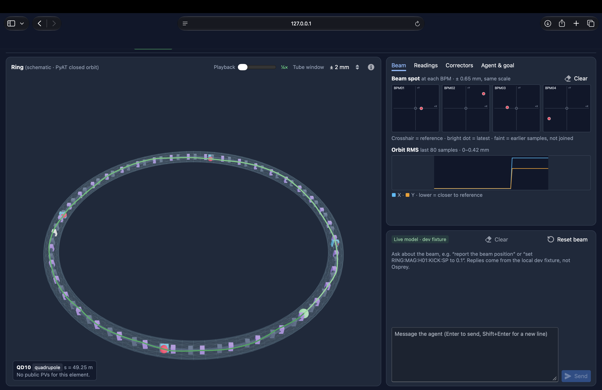
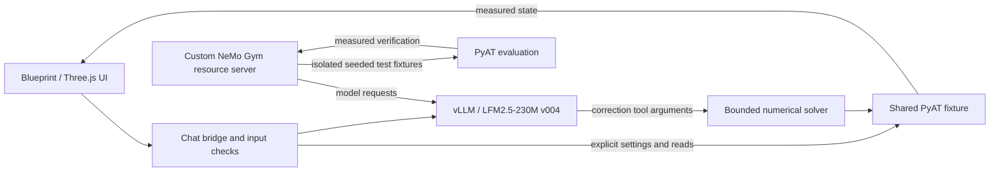

# HackRing

Local AI interface for a physics-based virtual particle accelerator. Goal: test whether small models can reduce operator setup effort through bounded tools and measured feedback.

**Team:** Collin Roach, Willow Stone, Zack Stone

**Repository:** https://github.com/zack-r-s/nvidia-redhat-small-models



## Quick start

Prerequisites: Python 3.12, [uv](https://docs.astral.sh/uv/), Node.js 22.12+ / npm, curl, lsof, and an installed vLLM server. The current demo uses vLLM Metal on Apple Silicon. Set `VLLM_BIN` if vLLM is outside PATH; the launcher also checks `~/.venv-vllm-metal/bin/vllm`.

```sh
git clone https://github.com/zack-r-s/nvidia-redhat-small-models.git
cd nvidia-redhat-small-models
cp .env.example .env
set -a
. ./.env
set +a
scripts/bootstrap_demo.sh --check
scripts/bootstrap_demo.sh --no-open
```

Open **http://127.0.0.1:5173/?driver=1**. Keep the terminal running; Ctrl-C stops services started by this launch. Ports 8001, 8002, and 5173 must be free. An existing matching v004 server on port 8000 is reused.

- Installs project/frontend dependencies; serves model v004; starts the shared PyAT fixture, chat, and viewer.
- No Docker, Osprey, or paid API key required for this demo. Internet access is needed for initial dependency/model downloads.
- `.env.example` contains the model, revision, server URL, and local placeholder API key. `VLLM_SERVE_ARGS` controls inference settings.
- With the matching model already running and dependencies installed: `scripts/dev_up.sh --live --no-open` starts only the fixture, chat, and viewer.
- Separate Osprey/EPICS integration: `scripts/bootstrap_demo.sh --osprey` (requires Docker; see [data documentation](datasets/README.md)).

## Stack and architecture

| Layer | Technology |
| --- | --- |
| Model | Liquid LFM2.5-230M; three supervised LoRA fine-tunes; demo checkpoint v004 |
| Inference | vLLM; vLLM Metal on the development Mac |
| Physics and control | PyAT, SciPy bounded response-matrix solver, FastAPI |
| UI | React, Blueprint, Three.js, Vite |
| Evaluation | NVIDIA NeMo Gym 0.4.0; custom PyAT resource servers |
| Data generation | Xopt, Osprey, EPICS; additional local PyAT measurements |



20-cell, 1 GeV simulated ring; four beam-position monitors; eight correctors; [24 process variables](data/pv_contract.json). The chat and viewer share one plant. Gym uses separate test fixtures.

## Reproduce the demo

Enter these prompts in the chat:

```text
Report beam position.
Set the first horizontal corrector to an absolute kick of +0.05 mrad, then report the horizontal beam position at the first BPM.
Center the beam in both planes.
Report all sensor data.
Set RING:MAG:H01:KICK:SP to 0.5 mrad.
```

- Read the sensors, change one magnet, request centering, compare measured before/after RMS.
- Explicit numeric writes and natural device aliases are handled by code.
- The model supplies correction-tool arguments; the solver computes magnet settings.
- The final command exceeds the configured ±0.35 mrad limit and is blocked in software. This is not learned refusal behavior.
- **Reset beam** restores the seeded initial state. The green path is a sampled PyAT closed orbit; playback speed is a display setting.

Read-only health checks:

```sh
curl -fsS http://127.0.0.1:8000/v1/models
curl -fsS http://127.0.0.1:8002/chat/health
curl -fsS http://127.0.0.1:8001/state
```

## Data and training

| Version | Provenance |
| --- | --- |
| v001 | 4,096 Xopt read/write/read attempts across 64 simulated episodes, collected through Osprey/EPICS; no physical machine data |
| v002 | Measured control conversations and a response-matrix teacher fitted from training data; GPT-generated wording augmentation |
| v003 | Canonical served examples plus additional measured local PyAT examples |
| v004 | Fresh local PyAT examples for correction direction/effort selection; numerical settings supplied by the solver; no GPT wording pass |

All three fine-tunes start from `LiquidAI/LFM2.5-230M`. Model and dataset tags match (`v002`, `v003`, `v004`).

- [Public datasets](https://huggingface.co/datasets/zack-r-s/hackring-pyat-control) · [public checkpoints](https://huggingface.co/zack-r-s/hackring-LFM2.5-230M)
- [Generation commands, schemas, and provenance](datasets/README.md) · [training configurations and release mapping](training/README.md)
- Historical GPT augmentation required an API key; running the demo or using the published data does not.

## NeMo Gym and results

Custom resource servers expose control tools, reset a seeded simulator per episode, and verify measured outcomes. Gym evaluates the models; supervised fine-tuning happens separately.

| Evaluation | Original 230M | Final v004 | Scope |
| --- | ---: | ---: | --- |
| Local correction-direction selection | 5/10 | 10/10 | Ten distinct prompt wordings after deduplicating 28 cases; greedy CPU inference; direction only |
| Mark III Gym correction skill | 73/112 | 72/112 | 28 tasks × four repeats; measured correction success |
| Mark IV Gym operator requests | 11/144 | 20/144 | 36 prompts × four repeats; all successes were no-write cases; both models scored zero on read/action cases |

No overall Gym correction improvement is established. Sources: [base local traces](evals/mark-iii/skill/base/traces.jsonl), [v004 local traces](evals/mark-iii/skill/v004/traces.jsonl), [Mark III protocol/results](evals/mark-iii/README.md), [Mark IV protocol/results](evals/mark-iv/README.md).

To reproduce the v004 correction-skill Gym run with the pinned model already serving:

```sh
uv venv --python 3.12 var/gym-cli
uv pip install --python var/gym-cli/bin/python nemo-gym==0.4.0
export VLLM_MODEL_NAME=LFM2.5-230M
export VLLM_MODEL_SOURCE=zack-r-s/hackring-LFM2.5-230M
export VLLM_MODEL_REVISION=14419bfc11d03da0fb92902a7cd15e7d2a9d0fa4
scripts/run_gym_mark_iii.sh skill --num-repeats 4
```

## Limitations and next steps

- Simulation proof of concept; no demonstrated facility uptime, fabrication-yield, or operator-time improvement.
- Small fixed plant and narrow training data; unfamiliar instructions remain unreliable.
- Direction selection is not full task success. Local harness-assisted and raw Gym scores measure different behavior.
- Numerical bounds are software checks, not a complete machine-protection system.
- Next: improve unfamiliar-command handling; compare against scripts and larger models; measure operator time and edge-device latency/memory.

## Checks

```sh
PYTHONPATH=src:scripts .venv/bin/python -m pytest -q tests
npm --prefix frontend run build
```
